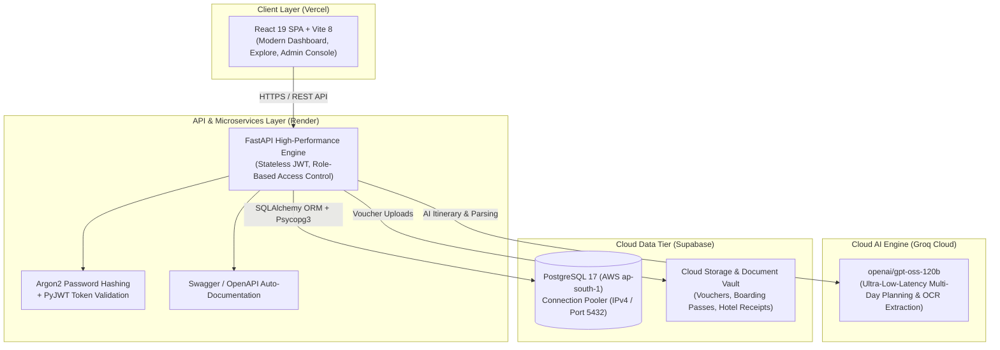

# 🌍 TripAI — Autonomous AI Travel Operations & Booking Platform

[](https://fastapi.tiangolo.com/)
[](https://react.dev/)
[](https://vitejs.dev/)
[](https://supabase.com/)
[-F55036?style=for-the-badge)](https://groq.com/)
[](https://render.com/)
[](https://vercel.com/)

> **A modern, full-stack, cloud-native travel management platform powered by high-speed Large Language Models (Groq Cloud) and enterprise relational data architecture (Supabase PostgreSQL).**

---

## 🔗 Live Deployments

| Component | Service | URL |
| :--- | :--- | :--- |
| **Frontend Web App** | Vercel | [aitraveloperationsplatform.vercel.app](https://aitraveloperationsplatform-11n0ke6m3-acme-9507.vercel.app) |
| **Backend REST API** | Render | [ai-travel-operations-platform-1.onrender.com](https://ai-travel-operations-platform-1.onrender.com) |
| **Interactive API Docs** | Swagger / OpenAPI | [ai-travel-operations-platform-1.onrender.com/docs](https://ai-travel-operations-platform-1.onrender.com/docs) |

### 🔑 Demo Credentials for Evaluation

| Role | Email | Password | Permissions |
| :--- | :--- | :--- | :--- |
| **Platform Administrator** | `shridhar@example.com` | `Test@12345` | Full access: PostgreSQL Data Explorer, global metrics, inventory management |
| **Standard Traveler** | `testuser123@example.com` | `password123` | AI itinerary creation, booking catalog, document vault, profile |
| *New Users* | *Any valid email* | *Self-register* | Instant account provisioning via `/register` |

---

## 💡 System Architecture



---

## ✨ Key Features & Technical Highlights

### 1. Autonomous AI Itinerary Generator
* **Sub-Second Generation**: Utilizes Groq Cloud's LPU inference running `openai/gpt-oss-120b` to synthesize realistic, chronological multi-day travel itineraries based on user destinations, dates, budgets, and interests.
* **Structured Persistence**: Generated itineraries are parsed and automatically persisted into structured PostgreSQL entities (`trips`, `itinerary_days`, `itinerary_activities`).

### 2. End-to-End Booking & Voucher Confirmation
* **Catalog Exploration**: Real-time searchable inventory of hotels and local experiences with pricing, durations, and ratings.
* **Direct Voucher Confirmation**: Travelers can upload PDF vouchers or photo receipts to pending bookings. The platform validates the file, triggers AI document parsing, and transitions booking status to `confirmed`.

### 3. AI Document Parsing Vault
* **Document Extraction**: Upload flight tickets, hotel reservations, or visas. The backend extracts reservation numbers, dates, costs, and passenger info directly into structured records.
* **Hybrid Storage Architecture**: Configured with automated Supabase Cloud Storage streaming, with transparent local fallback.

### 4. Admin Operations Console & PostgreSQL Explorer
* **Live Database Inspection**: Administrators can click on metric cards (**Total Users**, **Total Trips**, **Total Bookings**, **Catalog Hotels**) to execute direct relational queries against PostgreSQL with instant live table previews.
* **Real-time Client-side Search**: Multi-field search across users, travel dates, reservation IDs, and payment amounts.

### 5. Enterprise Security & Architecture
* **Cryptographic Security**: Industry-standard **Argon2** password hashing with salt generation.
* **Stateless Authorization**: Short-lived, digitally signed JWTs containing role assertions (`admin`, `travel_agent`, `customer`).
* **High Availability Database**: Hosted on Supabase Cloud PostgreSQL with IPv4 session pooler (`aws-0-ap-south-1.pooler.supabase.com:5432`) to eliminate IPv6 network routing boundaries.
* **Automated 24/7 Keep-Alive**: Continuous GitHub Actions cron daemon to maintain active database status.

---

## 🛠️ Technology Stack

| Layer | Technologies |
| :--- | :--- |
| **Frontend** | React 19, Vite 8, React Router v7, Lucide Icons, Modern Responsive CSS |
| **Backend** | Python 3.12+, FastAPI, Uvicorn, Pydantic v2 |
| **ORM & Database** | SQLAlchemy 2.0, Psycopg 3, Supabase Cloud PostgreSQL 17 |
| **AI / Machine Learning** | Groq Cloud API (`openai/gpt-oss-120b`), Ollama fallback |
| **Authentication** | OAuth2 Bearer, JWT (`PyJWT`), Argon2 (`argon2-cffi`) |
| **Background / Queue** | Celery 5.6, Redis (for asynchronous OCR jobs) |
| **Hosting & CI/CD** | Render (Web Service), Vercel (SPA Deployment), GitHub Actions (Cron Keep-Alive) |

---

## 🗄️ Database Schema & Entities

The platform manages a relational schema across 10 interconnected tables:

* `users` — Authentication credentials, user profile details, and role assignments (`admin`, `travel_agent`, `customer`).
* `destinations` — Curated travel cities, country tags, descriptions, and media assets.
* `hotels` — Property catalog, nightly rates, star ratings, and amenities.
* `activities` — Bookable excursions, location coordinates, durations, and pricing.
* `trips` — Traveler journeys, destination linkages, budget constraints, travel windows, and statuses.
* `itinerary_days` & `itinerary_activities` — Chronological daily schedules with time allocations.
* `bookings` — Hotel and activity reservation records with financial amounts and status tracking.
* `travel_documents` — Uploaded vouchers, extracted JSON metadata, and status.
* `notifications` — Real-time event notifications for booking confirmation and itinerary changes.

---

## 🚀 Local Development Setup

### Prerequisites
* **Python 3.10+**
* **Node.js 18+** & npm
* **PostgreSQL** (or a free Supabase cloud instance)

### 1. Clone the Repository
```bash
git clone https://github.com/shridharganiger/Ai_Travel_Platform.git
cd Ai_Travel_Platform
```

### 2. Backend Setup
```bash
cd Backend
python -m venv venv

# Windows
.\venv\Scripts\activate
# macOS/Linux
source venv/bin/activate

pip install -r requirements.txt
```

Create a `Backend/.env` file:
```env
DATABASE_URL=postgresql+psycopg://postgres.<project-ref>:<password>@aws-0-ap-south-1.pooler.supabase.com:5432/postgres?sslmode=require
GROQ_API_KEY=your_groq_api_key_here
GROQ_MODEL=openai/gpt-oss-120b
JWT_SECRET_KEY=your_super_secret_jwt_key
JWT_ALGORITHM=HS256
```

Start the Backend Server:
```bash
uvicorn main:app --reload --port 8000
```
API Documentation will be live at: [http://127.0.0.1:8000/docs](http://127.0.0.1:8000/docs)

### 3. Frontend Setup
In a new terminal window:
```bash
cd Frontend
npm install
npm run dev
```
The Frontend client will be running at: [http://localhost:5173](http://localhost:5173)

---

## 🚢 Deployment Configuration Reference

### Render (Backend Service)
* **Environment**: `Python 3`
* **Root Directory**: `Backend`
* **Build Command**: `pip install -r requirements.txt`
* **Start Command**: `uvicorn main:app --host 0.0.0.0 --port 10000`

### Vercel (Frontend SPA)
* **Framework Preset**: `Vite`
* **Root Directory**: `Frontend`
* **Build Command**: `npm run build`
* **Output Directory**: `dist`
* **Single Page App Routing**: Handled via `vercel.json` rewrites.

---

## 👨‍💻 Author

**Shridhar Ganiger**  
*Full-Stack Engineer & AI Applications Developer*  
* GitHub: [@shridharganiger](https://github.com/shridharganiger)
